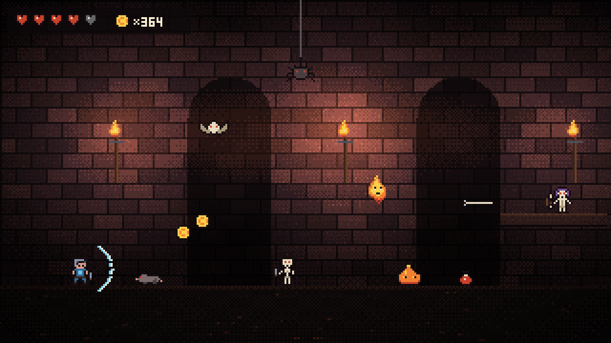

# Draugr's Delve

A souls-like pixel dungeon side scroller that runs in the browser, on phone or PC. 100 floors: ten hand-built areas (one enemy and one lesson each, ending with the Draugr Jarl), then 90 generated floors with a Jarl hall every tenth floor, and New Game+ after floor 100.



## Play

Quickest: double-click `index.html`. No install, no build.
Keep the `docs/music` folder next to it for the title music (without it the game falls back to generated music).

### Run a local server
Handy for keeping up with the repo (pull, refresh) and for playing on a phone on the same Wi-Fi.

Windows (PowerShell or cmd), first time:
```
git clone https://github.com/neweggeek/draugrs-delve.git
cd draugrs-delve
py -m http.server 8000
```
Then open http://localhost:8000 in the browser. Stop the server with Ctrl+C.

To update later:
```
cd draugrs-delve
git pull
py -m http.server 8000
```
Use `python` instead of `py` on Mac or Linux, or if `py` is not found. Any free port works (`8080`, `5500`, ...).

Phone on the same Wi-Fi: find the PC's address with `ipconfig` (IPv4 Address, for example `192.168.1.20`), then browse to `http://192.168.1.20:8000` on the phone. Windows may ask to allow Python through the firewall the first time; allow it on private networks.

Check you have the new build: the version (for example `V15 2026-11-09 HI-RES ART`) is shown small at the top center of the screen. If it still shows the old one, hard refresh with Ctrl+F5 (Cmd+Shift+R on Mac).

Saves live in the browser's localStorage per address, so `file://`, `localhost:8000` and the claude.ai artifact each keep their own save.

## Controls

| Action | PC | Phone | Gamepad |
|---|---|---|---|
| Move | A / D or arrows | left pad | stick or D-pad |
| Jump (hold for higher) | W / Space / Up | JUMP | A |
| Attack (hold for heavy) | J or left click | ATK | X |
| Block (block late to parry) | K or right click | BLOCK | LB / LT / RT |
| Roll | L or Shift | ROLL | B |
| Drink flask | Q | HEAL | Y |
| Cast fireball (tap), hold to charge a big one | F | FIRE | RB |
| Use: bonfire, chest, altar, rest shrine | E | USE | D-pad up |
| Drop through a ledge | S or Down | USE (shows DROP) | stick or D-pad down |
| Bag (inventory) | I | BAG | Select |
| Pause menu | Esc | MENU | Start |
| Sound on / off | M | speaker button | |
| Switch 3D / 2D view | V | 2D / 3D button | |

In the bag: C combine, X salvage (X / Y on a pad, buttons on touch). Arrows or wheel scroll the grid.
Title floor picker: A / D one floor, Shift + A / D ten floors (<< >> on touch, LB / RB on a pad).
A controls screen opens on every new game and from the pause menu (CONTROLS).

Telegraphs: white flash = block or parry, red flash = roll away.

## Features
- 3D view: the dungeon is drawn in 3D with WebGL while the sprites stay pixel art. V or the 2D / 3D button switches to the flat view. Falls back to 2D without WebGL.
- Stamina-based combat: light and heavy attacks, 3-hit combos, block, parry and riposte, roll with i-frames, guard break, poise.
- Ten hand-built areas, one enemy each: rats, bats, thralls, archers, spiders, slimes, wisps, shamblers, shieldbearers, the Jarl. Deeper floors add green, blue and red slimes, spider warriors and the Spider Queen mini boss, plus mixed traits (IRON, SWIFT, GIANT, ...) and gold elites.
- Concept art look: mossy stone halls with arches, portcullises and chains, spike traps, and painted monsters with full animation (idle, walk, wind-up, strike, hurt).
- Every mob has a rule to learn (rats hunt in packs, thralls reassemble, wisps glow, ...). See `docs/DESIGN.md`.
- Bonfires: rest to heal, refill flasks, level up, learn magic, cook, repair. Resting brings monsters back.
- Rest shrine in the middle of each area: a safe zone that also works as a checkpoint.
- Die and your XP stays where you fell. Get back to it or lose it.
- Three classes (Knight, Berserker, Rogue), four stats (VIT, END, STR, DEX).
- Loot with rarity (common to legendary), five gear slots, item weight and an overload limit.
- Crafting: salvage gear into rune dust, combine copies for +1 to +10, rune altar every third floor to craft or temper.
- Durability: weapon, shield and armor wear down; repair at a bonfire.
- Status effects: bleed, poison, burn, frost, on you and on monsters.
- Cooking: monster parts make one meal buff at a time.
- Fireball: learn it for XP at a bonfire (MAGIC) or free by beating the Jarl. Hold to charge: bigger, faster, harder hitting. Magic skills (Ember, Kindle, Focus, Inferno, Twin Flame) upgrade it with XP.
- Music: title theme (`docs/music/dungeon_music_preview.mp3`), generated music per area with a fight layer, shrine lullaby, boss theme.
- Progress saves in the browser (also when the tab is hidden or closed).

Full rules and numbers: `docs/DESIGN.md`.

## Test
```
pip install playwright
python -m playwright install chromium   # or set CHROME=/path/to/chrome
python tests/smoke_test.py
```
It must end with `ALL PASSED`. Run it after every change to `index.html`.

## Tools (optional)
`tools/` holds the art and music generators from the concept phase. They need `pip install numpy pillow` and write to `tools/out/`.

## Repo
- `index.html`: the whole game (HTML, CSS, JS in one file)
- `tests/`: headless checks
- `tools/`: art and music generators
- `docs/`: design notes, concept art, music, screenshots
- `CLAUDE.md`: code map and conventions for working on the game

## Releasing
Bump `VERSION` near the top of the script in every change to the game, then re-publish `index.html` as the claude.ai artifact.
